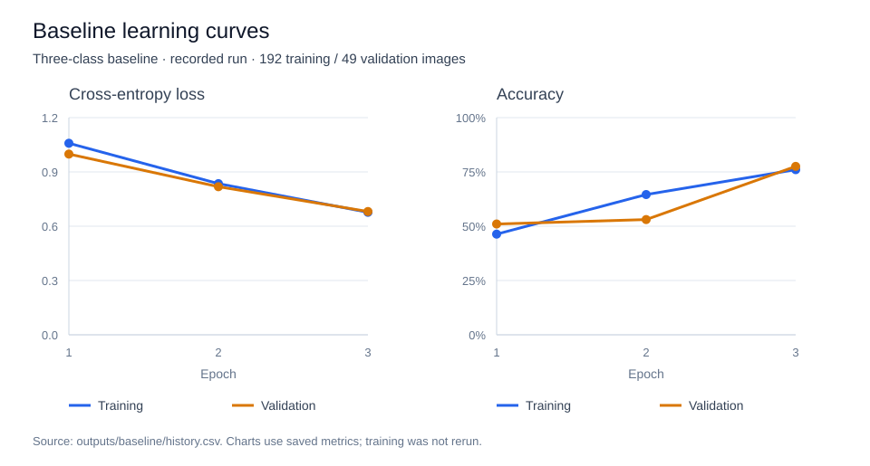
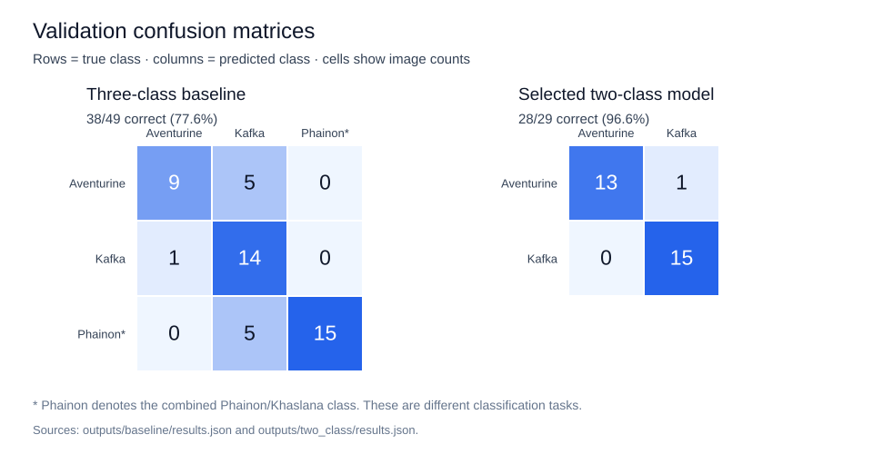
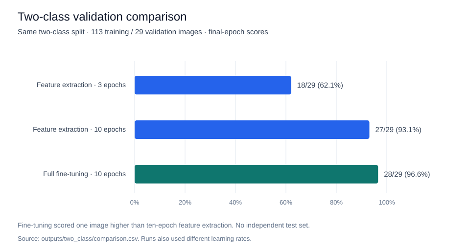

# Honkai: Star Rail Character Classifier

Colab opens the notebook. Rerunning requires the original dataset and local assets described below.

I adapted the ants-and-bees exercise from my transfer-learning course to recognize characters from Honkai: Star Rail. I used a pretrained ResNet18 in PyTorch to compare feature extraction and fine-tuning on a small image dataset.

## Results

| Experiment | Training images | Validation correct |
| --- | ---: | ---: |
| Three classes, feature extraction, 3 epochs | 192 | 38/49 (77.6%) |
| Two classes, feature extraction, 3 epochs | 113 | 18/29 (62.1%) |
| Two classes, feature extraction, 10 epochs | 113 | 27/29 (93.1%) |
| Two classes, full fine-tuning, 10 epochs | 113 | 28/29 (96.6%) |

The three-class baseline used Aventurine, Kafka, and a combined Phainon/Khaslana class. The follow-up trained on Aventurine and Kafka only. Fine-tuning got one more validation image right than feature extraction at ten epochs. The validation split was used to choose the best run, and there was no independent test set. The two experiments use different labels and validation sets.

I also passed 99 Phainon/Khaslana images to the two-class model. It assigned 94 to Aventurine and 5 to Kafka. The model always chooses a trained class, so even a high softmax score can occur for an unseen character.

## Visual results

These charts show the committed results; training was not rerun to create them.

### Fresh-image examples

| Aventurine | Kafka | Phainon/Khaslana | Himeko (unseen) |
| :---: | :---: | :---: | :---: |
|  |  |  |  |
| Predicted: phainon/khaslana (39.8%) | Predicted: kafka (40.1%) | Predicted: phainon/khaslana (62.3%) | Predicted: phainon/khaslana (50.4%) |

These are the four baseline demo inputs, linked from the pinned [StarRailRes source](https://github.com/Mar-7th/StarRailRes/tree/dbe8cdfcfb0bf657b9fe1cf92d5537f118ccb487). Scores are top softmax scores, not calibrated confidence. Himeko is outside the trained classes. [Predictions](outputs/fresh-images/predictions.csv) · [Source manifest](outputs/fresh-images/source-manifest.json).

## Dataset

| Class | 2D illustrations | 3D renders | Total |
| --- | ---: | ---: | ---: |
| Aventurine | 1 | 68 | 69 |
| Kafka | 1 | 72 | 73 |
| Phainon/Khaslana | 0 | 99 | 99 |

These are the training and validation images from the three-class baseline. The four separate fresh examples were 2D illustrations. Counts by medium came from visual review.

## Explore the project

- [Notebook](homework.ipynb) with the data pipeline, training code, and evaluation
- [Three-class results](outputs/baseline/results.json) and [two-class comparison](outputs/two_class/comparison.csv)
- [Unseen-character predictions by group](outputs/two_class/group_summary.csv) and [fresh-image predictions](outputs/fresh-images/predictions.csv)

The notebook code and recorded metrics are available to inspect on GitHub. To rerun locally, use the [recorded environment](requirements-lock.txt), supply the original data under `dataset/train/<class>/` and `dataset/val/<class>/`, and place the demo files listed in the [source manifest](outputs/fresh-images/source-manifest.json) under `outputs/fresh-images/`. The optional Himeko group uses `outputs/unseen/himeko/`. The raw dataset, demo artwork, and trained checkpoints are kept locally. Honkai: Star Rail artwork belongs to its respective rights holders.
